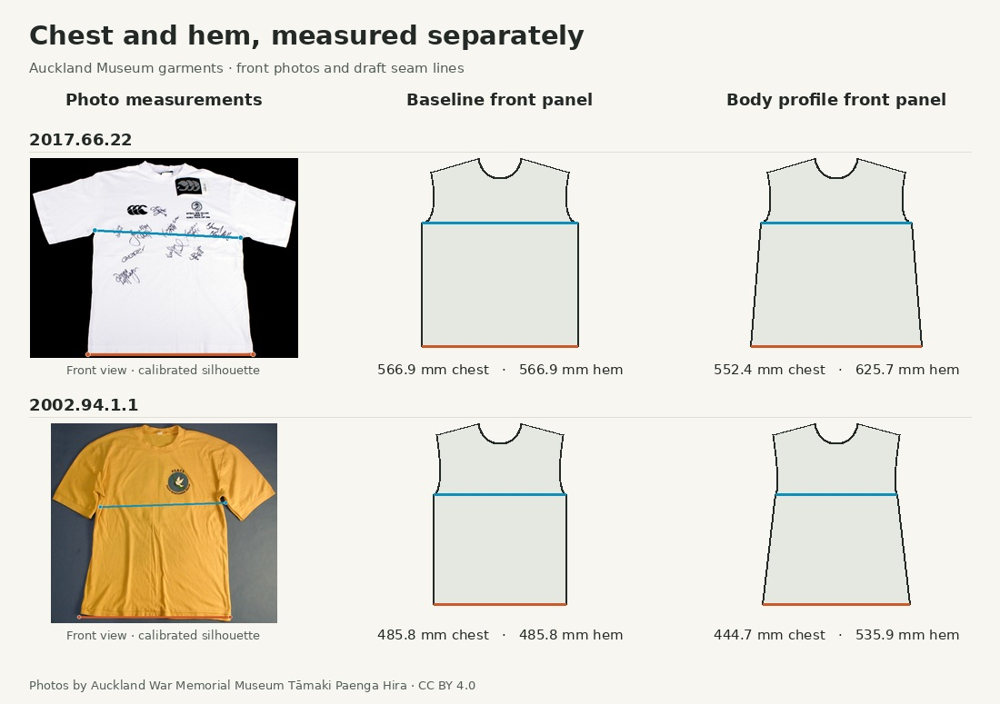

# 分开估计 T 恤胸宽与下摆宽

奥克兰博物馆的两件实拍 T 恤都有较宽的下摆。基础纸样以同一宽度画腋下与下摆。新增的双面测量流程从外轮廓拟合左右侧缝，从近侧缝的袖底定位推断腋下，并用下摆中心的可见折线高度估计两端宽度。两面宽度相符且候选裁片能配缝时，采用测量结果。模型保留取点、侧缝拟合残差和原回归值，证据不足时沿用原回归。当前每侧只用一条直侧缝，褶皱和明显曲线会影响量测。

## 平铺照与纸样

两次归档使用相同训练权重和原照片。白色款用馆方记录的 690 mm 后中衣长定尺度，预测时留出馆方胸宽 515 mm 和肩宽 505 mm。黄色款从两面的实体软尺获取尺度。馆方没有提供可独立评分的黄色款胸宽或两件的下摆宽。图中的蓝线和橙线分别标记程序从正面推断的胸宽和下摆宽。照片来自 Auckland War Memorial Museum Tāmaki Paenga Hira，许可为 CC BY 4.0。[原图与许可](paired-photo-study.md)



| 藏品 | 原胸宽 | 新胸宽 | 新下摆宽 | 独立胸宽误差 |
| --- | ---: | ---: | ---: | --- |
| 白色 2017.66.22 | 566.893 mm | 552.380 mm | 625.670 mm | +51.893 → +37.380 mm |
| 黄色 2002.94.1.1 | 485.786 mm | 444.725 mm | 535.945 mm | 暂无馆方参考 |

主方案的白色款肩宽误差为 −2.318 mm。换用另一条可见后领边定尺度，新胸宽误差为 +17.410 mm，原算法在同一替代标定下是 +31.924 mm。两种读数反映了量取后领的位置对毫米误差的影响，主结果采用预先固定的取点。黄色款的肩宽预测大于腋下胸宽，裁片净线和袖窿配缝均通过检查。两件均通过五片毫米 DXF、十五条接缝、纸样哈希与四处成衣开口的检查。[逐视角数据、标定和输出哈希](body-profile-study.json)

| 原输入平铺照复投影 | 原轮廓交并比 | 新轮廓交并比 | 轮廓距离 P90 |
| --- | ---: | ---: | ---: |
| 白色正面 | 86.44% | 86.88% | 41.07 → 36.00 mm |
| 白色背面 | 77.15% | 77.44% | 64.00 → 64.00 mm |
| 黄色正面 | 89.29% | 89.33% | 36.88 → 32.80 mm |
| 黄色背面 | 87.92% | 87.48% | 34.00 → 33.99 mm |

## 独立挂拍检查

白色款的新纸样另在人台上重跑带臂与无臂两种仿真，并与前次实验使用的固定相机参数、三维照片外包络和留出正面 #01 对照。两版无臂模拟的留出正面轮廓交并比为 **76.03% → 76.18%**，轮廓距离 P90 为 **55.24 → 55.33 mm**。新无臂 GLB 的前后跨度从 **293.29 mm** 增至 **331.96 mm**，实物外包络约 **270 mm**。到外包络的单向面积加权距离 P90 从 **46.32 mm** 增至 **47.48 mm**。修改让平铺衣身尺寸更接近目录和照片，悬挂深度的差异更大。还需独立扫描及支撑与面料参数，才能核对这些差异来自模拟垂坠、影像标定还是原衣物的摆放。[同件藏品的挂拍、标尺与方法](mannequin-study.md)

## 复现

```sh
python -m examples.evaluate_auckland_tees --body-profile -o build/auckland-profile
python -m superarchiveallclo.capture build/auckland-profile/netball/data/paired.json \
  --model models/tee-vision.npz --blind --form torso_only -o build/auckland-profile/netball/torso-only
python -m examples.evaluate_auckland_drape build/auckland-profile/netball/review/archive \
  --torso-only-archive build/auckland-profile/netball/torso-only -o build/auckland-profile/netball/drape
```

每件的 `study.json` 记录两面平铺对照，`netball/drape/study.json` 记录两种人台的独立挂拍对照。对照版本在各自新的输出目录中运行相同命令，省略第一行的 `--body-profile`。
