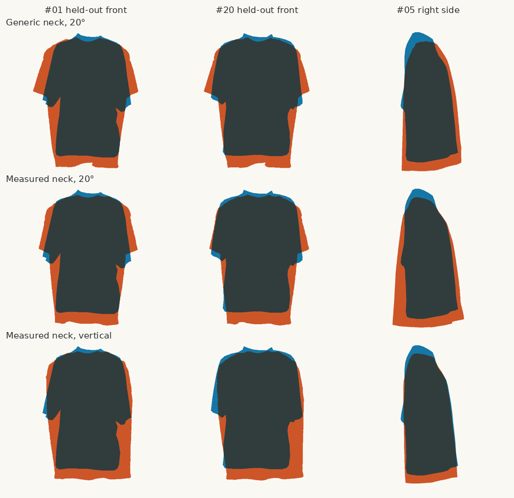

# 实物人台颈部和衣袖起始位置对垂坠的影响

从奥克兰博物馆 `2017.66.22` 的正背平铺实拍生成一套纸样，并用同一套纸样重跑人台仿真。正视挂拍 #02 的裸露颈部两侧用于计算横向宽度，两张侧视挂拍 #03 和 #05 的露出后缘用于估算俯角。程序沿标注窗口自动检测颜色边缘，得到宽度 **100.82 mm**，左右侧角度分别为 **23.33°、20.13°**，取均值 **21.73°**。这些照片用实物立杆转移尺度，角度仍受相机偏离正侧的影响。颈部与部分上躯干轮廓按该角度建模，衣物遮住的胸、腰深度沿用通用几何。照片由 Auckland War Memorial Museum Tāmaki Paenga Hira 发布。[照片与标尺](../examples/auckland-drape.json) · [CC BY 4.0](https://creativecommons.org/licenses/by/4.0/)

对照使用三种接触支撑仿真，分别采用通用颈部与 20° 初始袖角、测量颈部与 20° 袖角、测量颈部与垂直袖位。三版均使用同一纸样、38 帧求解、同一参考物性和实拍贴图。模型以人台颈顶基准注册。#01 和 #20 的衣物轮廓留作评分，两张相机由实体标尺及人台底板标定。侧视仍采用立杆定尺的近正交相机。程序按距基准每 150 mm 的图像带计算相交、仅模型覆盖及仅实物覆盖像素，并对九处照片三角测量点计算到 GLB 的最短距离。[相机标定](auckland-stand-study.md) · [纸样和结构对照](photo-landmark-study.md)

| 指标 | 通用颈部，20° | 实测颈部，20° | 实测颈部，垂直袖位 |
| --- | ---: | ---: | ---: |
| 留出 #01 轮廓交并比 | 79.13% | 80.69% | 79.21% |
| 留出 #20 轮廓交并比 | 82.57% | 83.20% | 79.70% |
| 留出 #01 轮廓距离 P90 | 56.85 mm | 56.86 mm | 62.12 mm |
| 留出 #20 轮廓距离 P90 | 53.57 mm | 61.04 mm | 70.93 mm |
| 左侧 #03 轮廓交并比 | 78.12% | 69.27% | 81.56% |
| 右侧 #05 轮廓交并比 | 77.24% | 72.97% | 85.68% |
| 九处三维点到 GLB 距离中位数 | 9.44 mm | 11.76 mm | 7.60 mm |
| 九处三维点到 GLB 距离 P90 | 19.01 mm | 26.26 mm | 25.11 mm |
| 网格边相对纸样长度的绝对变化 P95 | 13.61% | 13.75% | 15.59% |



橙色为模型独有区域，蓝色为实物独有区域，深色为重合。垂直袖位在两张正面上将基准下方 150–450 mm 的过量覆盖分别减少约 **59%** 和 **70%**，600 mm 以下的过量覆盖却增加约 **41%** 和 **42%**。部分侧拍里模型投影触及画面边缘，轮廓分数按可见画幅计算。垂直版求解中测到最大 2.53 mm 的人台穿入，导出表面的此项读数为 0 mm。两项设置保留为可选输入，当前通用参考仍用于默认归档。实际布料、遮住的人台表面与下半衣身的直接扫描可进一步核对误差来源。[逐视角、分段计数及文件哈希](display-neck-study.json)

## 复现

```sh
python -m examples.evaluate_auckland_archive --case netball --reprojection-limit-mm 25 -o build/auckland-netball
python -m examples.evaluate_auckland_stand build/auckland-netball -o build/auckland-stand
python -m examples.evaluate_auckland_display_neck build/auckland-netball \
  --cameras build/auckland-stand/cameras.json -o build/auckland-neck-20
python -m examples.evaluate_auckland_display_neck build/auckland-netball \
  --cameras build/auckland-stand/cameras.json --initial-sleeve-angle 0 -o build/auckland-neck-0
```

使用 Blender 4.3.2。`study.json` 保留逐视角分段分数、源照片和交付文件哈希。`control/` 与 `measured-neck/` 保存每张照片的叠图。归档入口 `superarchiveallclo.capture --form display_torso --display-neck <路径>` 接受同类型测量，归档保存 `model/display-neck.json` 和仿真记录，回读时校验两者是否对应。
