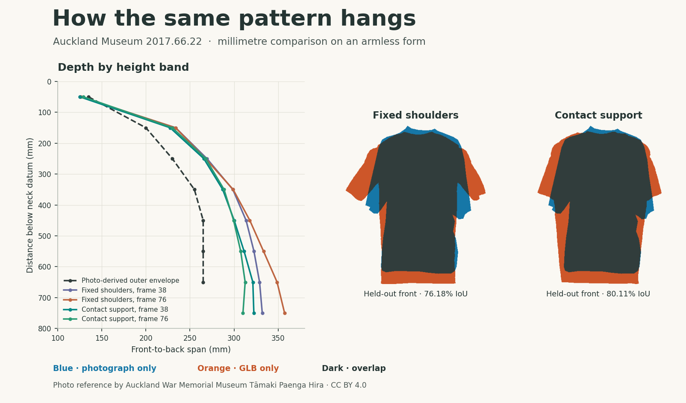

# 同版纸样的展示人台垂坠

在奥克兰博物馆藏品 `2017.66.22` 上，带独立下摆宽的纸样生成了完整的毫米 DXF、GLB 和 Blender 工程。用同一纸样比较无臂人台上的肩部固定和接触支撑。两种设置使用相同的通用人台几何和参考针织参数。展台模式让布料靠与人台接触承托，袖子从偏离竖直方向 20° 的位置起算。肩部固定模式在布料求解中固定肩缝的一组顶点，袖子起始角为 45°。角度是通用的初始化设定，未用实拍拟合网格。[原纸样和独立尺寸结果](body-profile-study.md)

## 实物对照

四次归档采用同一份纸样 `e01dc893…ea0` 和相同的照片标定，均回读核实了五片毫米 DXF、十五条接缝和四处成衣开口。三维外包络由四张挂拍生成，第五张正面挂拍留作评分。工具用实际交付的 GLB 计算正背及两侧投影、外包络外的偏离，并按颈顶以下每 100 mm 统计左右宽度和前后深度。照片来自 Auckland War Memorial Museum Tāmaki Paenga Hira，许可为 CC BY 4.0。[照片、标尺、颈顶基准与核查方法](mannequin-study.md)

| 指标 | 肩部固定 38 帧 | 肩部固定 76 帧 | 接触支撑 38 帧 | 接触支撑 76 帧 |
| --- | ---: | ---: | ---: | ---: |
| 留出正面轮廓交并比 ↑ | 76.18% | 76.55% | 80.11% | 79.21% |
| 留出正面轮廓距离 P90 ↓ | 55.33 mm | 54.49 mm | 54.23 mm | 58.69 mm |
| GLB 到外包络的单向面积加权距离 P90 ↓ | 47.48 mm | 48.47 mm | 38.65 mm | 38.47 mm |
| GLB 前后最大跨度 | 331.96 mm | 357.27 mm | 322.73 mm | 316.76 mm |
| 颈顶下方 600–700 mm 区间的前后跨度 | 328.91 mm | 348.76 mm | 321.29 mm | 312.57 mm |
| 导出前五帧间隔的顶点位移 P90 | 6.88 mm | 2.25 mm | 8.73 mm | 3.61 mm |



照片外包络在颈顶下方 600–700 mm 的前后跨度约 265 mm。接触支撑缩小了两种时长下的深度偏差，76 帧时该区间仍偏深约 48 mm。两组仿真延长后末段位移均下降，接触支撑的正面轮廓距离却从 54.23 mm 增至 58.69 mm。帧率和顶点位移用于检查布料是否仍在移动。布面褶皱和实际人台接触位置还需要直接三维测量验证。[逐视角误差、分段深度与归档哈希](drape-support-study.json)

## 其他实拍来源

实际下载并检查了犹他大学 ClothCap 发布的 `sample_frames.tar.gz` 和 `garment_data.tar.gz`。样本有同件研究用长袖 T 恤在 `04140` 时刻的 16 张同步原图，以及服装模板和初始化数组。两个压缩包和官方代码树均未列出该帧需要的 `camera_params_shirt_S.json`。目前可核对同一时刻的实拍视角，尚缺原始相机参数及该帧独立测得的布面几何。[原图及服装数据入口](https://graphics.cs.utah.edu/research/projects/two-level-cloth-capture-pattern/) · [配置和标定文件说明](https://github.com/Utah-Graphics-Lab/clothcap)

CTU Spread Garments 有短袖类别、正背标签、颜色和深度。已回读作者工具库中的三个样例标注，类别为裤装和 Polo。通过存档的发布页找到了平铺数据和样本的原 FTP 地址。本轮原地址连接失败，网页存档保留了发布页。作者限定数据用于科研和教学。[数据报告](https://cmp.felk.cvut.cz/ftp/articles/wagner/Wagner-TR-2013-25.pdf) · [存档发布页](https://web.archive.org/web/20170420172715id_/http://clopema.felk.cvut.cz/color_and_depth_dataset.html) · [样例与数据使用范围](https://github.com/CloPeMa/garment_dataset)

## 复现

先按[衣身轮廓实验](body-profile-study.md)生成 `build/auckland-profile`。其中 `netball/torso-only` 是 38 帧的肩部固定版本，`netball/drape/data/hull-reference.json` 记录实拍参考。

```sh
python -m superarchiveallclo.capture build/auckland-profile/netball/data/paired.json \
  --model models/tee-vision.npz --blind --form torso_only --drape-frames 76 -o build/fixed-76
python -m superarchiveallclo.capture build/auckland-profile/netball/data/paired.json \
  --model models/tee-vision.npz --blind --form display_torso -o build/display-38
python -m superarchiveallclo.capture build/auckland-profile/netball/data/paired.json \
  --model models/tee-vision.npz --blind --form display_torso --drape-frames 76 -o build/display-76

reference=build/auckland-profile/netball/drape/data/hull-reference.json
python -m superarchiveallclo.visual_hull build/auckland-profile/netball/torso-only \
  "$reference" -o build/fixed-38-evaluation
python -m superarchiveallclo.visual_hull build/fixed-76 "$reference" -o build/fixed-76-evaluation
python -m superarchiveallclo.visual_hull build/display-38 "$reference" -o build/display-38-evaluation
python -m superarchiveallclo.visual_hull build/display-76 "$reference" -o build/display-76-evaluation
```
