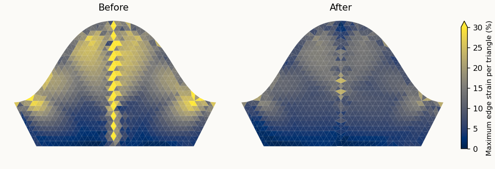

# 平铺网格与接缝应变

平铺袖片时，程序沿纵向折线布置三角网格，并让折线穿过袖山顶与袖口。然后在支撑平面内按纸样原始边长做整体松弛，保留肩点和三角面的朝向。袖底接缝使用两倍的边长权重，以减少局部挤压。报告按裁片和接缝记录应变，同时保存每条接缝两边的净纸样长度及缝合后的长度。

## 同一纸样的实物复评

两版使用同一套由 RGBench 实物扫描重建的纸样、同一输入袖角与同八帧复拍。纸样、输入点云、参考点云及 GLB 的校验信息在机器可读报告中。新版回读的平铺 GLB 保留四处开口，十五条接缝的两边具有相同的缝合长度。[数据集与 CC BY 4.0 许可](https://huggingface.co/datasets/RGBench/RGBench-Cloth-Sim2Real-v1) · [逐帧、分片与接缝报告](flat-mesh-relaxation.json)



每个色块表示该三角面三条边中最大的绝对应变。两图以同一毫米尺度显示右袖净纸样，颜色越亮代表与原纸样边长的差异越大。

| 同一纸样的指标 | 前版 | 新版 |
| --- | ---: | ---: |
| 全件网格边长绝对应变中位数 | 0.09% | 0.57% |
| 全件网格边长绝对应变 P95 | 12.17% | 8.37% |
| 全件网格边长绝对应变 P99 | 21.99% | 14.02% |
| 右袖网格边长绝对应变 P95 | 22.05% | 13.20% |
| 右袖底缝边长绝对应变 P95 | 20.33% | 7.58% |
| 右袖底缝缝合后长度，纸样为 110.47 mm | 106.63 mm | 106.33 mm |
| 右袖直接跨过折线的网格边 | 13 | 0 |
| 与实物的俯视轮廓交并比，八帧中位数 | 91.38% | 91.04% |
| 与实物的轮廓距离 P90，八帧中位数 | 27.76 mm | 29.23 mm |

高应变有所缓解，误差分布到更多边。袖底缝的局部变形降低，整条缝的长度差仍约 4 mm。轮廓边缘差增加约 1.5 mm。领条在新版仍有较高应变，其中净长系数为 0.85 的领条会在合缝时拉长。这里的对照衡量平铺支撑几何，同姿态试穿和材料物性仍需独立测量。

## 复现

```sh
python -m examples.evaluate_rgbench_scan --compare-legacy-flat -o build/rgbench-flat-relaxation
```

`flat-comparison/comparison.json` 和 `flat-legacy-comparison/comparison.json` 分别记录两版逐裁片和逐接缝数据。两个文件夹各有对应的 `flat-pose.glb`。[前版归档](sleeve-join-study.md)
