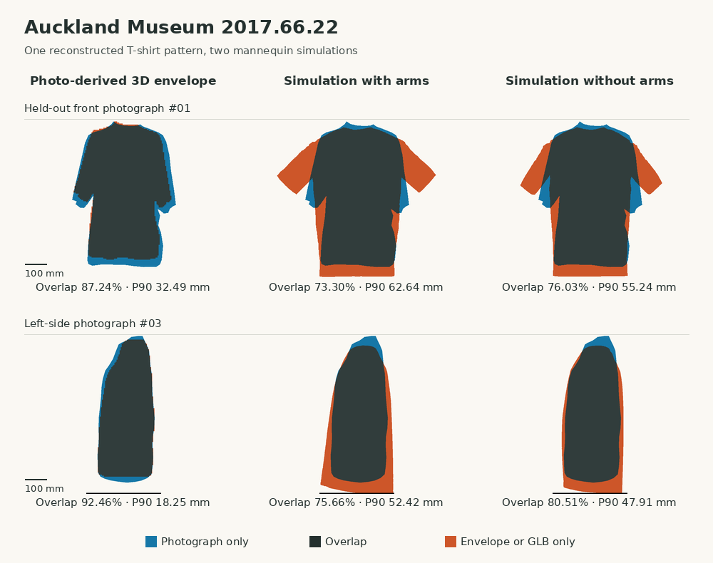

# 同件实物 T 恤的人台三维对照

奥克兰博物馆藏品 `2017.66.22` 的平铺正背照驱动模型生成纸样。目录中的后中衣长 690 mm 用于定尺度，胸宽和肩宽留作独立评分。主方案的纸样胸宽误差为 +51.893 mm，肩宽误差为 −2.318 mm。袖口内外两张特写提供翻边和缝线证据。两个仿真版本用完全相同的纸样 **`161ea0af…a0`**，均通过五片毫米 DXF 裁片、十五条接缝和四处开口的回读核查。[正背照盲测与结构特写](paired-photo-study.md)

## 独立参考

同件成衣在人台上的五张挂拍均留在纸样模型输入之外。正面 #02、左侧 #03、背面 #04 和右侧 #05 的人工外轮廓用于构造实物参考。较远的正面 #01 留出，用于检查参考外包络的投影和两次仿真。#20 同时拍到了藏品编号、支撑杆和两把实体尺。原图来自 Auckland War Memorial Museum Tāmaki Paenga Hira，许可为 CC BY 4.0。[#01 留出正面](https://commons.wikimedia.org/?curid=83524135) · [#02 正面](https://commons.wikimedia.org/?curid=83524136) · [#03 左侧](https://commons.wikimedia.org/?curid=83524137) · [#04 背面](https://commons.wikimedia.org/?curid=83524140) · [#05 右侧](https://commons.wikimedia.org/?curid=83524142) · [#20 尺度证据](https://commons.wikimedia.org/?curid=83524175) · [CC BY 4.0](https://creativecommons.org/licenses/by/4.0/)

程序在原图上用两把尺估计每像素 0.27778 和 0.27210 mm，平均尺度乘以自动检测的 65 px 支撑杆宽，得到 **17.87 mm** 的杆径估计。各挂拍用同一根杆的像素宽独立换算比例。按原图等比缩到 576 × 864 后，#01 到 #05 的尺度分别为 1.62465、0.95738、0.99284、0.99284 和 0.99284 mm/px。原点由杆中心和可见人台颈顶定位。两把尺的读数相差约 2.1%，只反映校准图上的局部差异。各轮廓按正交主视方向近似，馆方未提供逐视角内外参，杆、尺和衣料也有各自的距离，数字会受到透视和机位偏角影响。[原图哈希、标尺、原点与轮廓标注](../examples/auckland-drape.json)

程序取四个轮廓在 5 mm 三维体素网格上的共同可见空间，得到约 **460 × 270 × 650 mm** 的外包络（左右宽、前后深、垂直高）。包络投影在留出照的轮廓交并比为 **87.24%**，双向轮廓距离 P90 为 **32.49 mm**。包络内部的具体布面深度、褶皱和褶层仍需独立三维测量。

## 同版仿真

挂拍使用无手臂的人台。测试在通用人台模型上关闭两条上臂碰撞体，保留原纸样、胸躯、布料参数和求解设置。两次导出的实际 GLB 均只按颈顶平移到参考坐标。胸躯形状仍是通用近似，衣物网格未用挂拍拟合。

| GLB 对照 | 默认带手臂人台 | 无手臂人台 |
| --- | ---: | ---: |
| 留出正面轮廓交并比 ↑ | 73.30% | 76.03% |
| 留出正面轮廓距离 P90 ↓ | 62.64 mm | 55.24 mm |
| GLB 三角形中心在外包络外超过 5 mm 的面积比例 ↓ | 49.57% | 43.24% |
| GLB 到外包络的单向面积加权距离 P90 ↓ | 60.72 mm | 46.32 mm |

单向距离把包络内的三角形中心计为零，包络外取到最近边界体素中心的距离。无手臂版本在四个其余视角的 P90 也都降低，投影仍有明显偏差。馆方胸宽差值、未知的人台胸躯形状和采用参考布料参数，会共同影响模拟轮廓。[两次仿真的逐视角误差、尺度与哈希](mannequin-study.json)



蓝色是实物照片独有区域，橙色是包络或 GLB 独有区域，深灰色为重叠。同一行使用同一照片尺度和取景范围。左侧列由实物挂拍构建，右两列由同一套纸样分别计算。

## 复现

实测使用 Blender 4.3.2。原图按配置下载并核对 SHA-256。两个归档都由程序从平铺正背照生成毫米纸样并模拟。

```sh
python -m examples.evaluate_auckland_tees --case netball -o build/auckland-study
python -m superarchiveallclo.capture build/auckland-study/netball/data/paired.json \
  --model models/tee-vision.npz --blind --form torso_only -o build/auckland-torso-only
python -m examples.evaluate_auckland_drape build/auckland-study/netball/review/archive \
  --torso-only-archive build/auckland-torso-only -o build/auckland-drape
```

`study.json` 记录两个人台版本的结果。`volume/` 与 `torso-only-volume/` 保存逐视角叠图、毫米占用栅格 `hull.npz`、以米为单位的边界点云 `hull-boundary.ply` 和可复核的比较报告。可用 `python -m superarchiveallclo.visual_hull --help` 对其他近正交挂拍运行同一对照流程。
