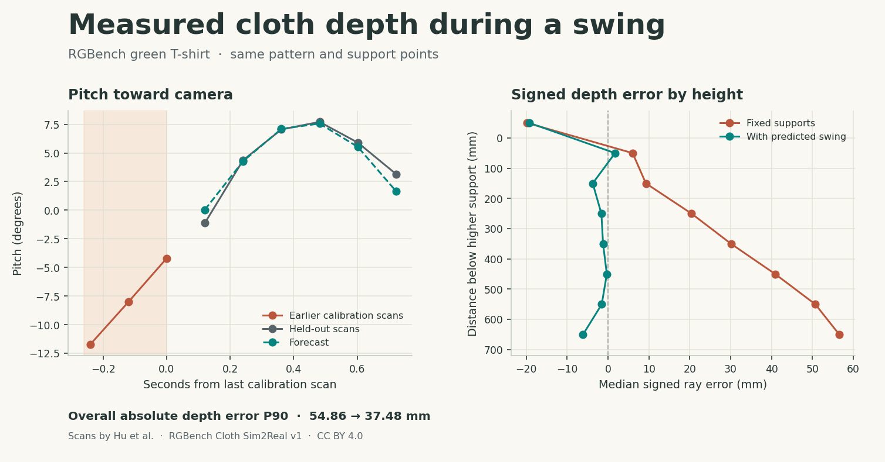

# 从实物点云核对悬挂布面深度

用 RGBench 的真实绿色圆领 T 恤验证同版纸样。平铺输入点云生成纸样和毫米 DXF，另取持续悬挂中的六帧扫描作为实物评分。在原有轮廓和最近点到面距离之外，程序现在从经标定的相机原点向每个测得的布面点投射视线。GLB 的首个交点与实测沿射线距离相减。正值表示预测布面更远离相机。两种模型只在都命中的实测射线上评分，报告各自及共同命中的数量。[原归档、分组及配缝](suspension-study.md) · [RGBench 数据与 CC BY 4.0 许可](https://huggingface.co/datasets/RGBench/RGBench-Cloth-Sim2Real-v1)

## 用早期扫描预测短时摆动

固定两个抓取点的重力仿真提高了正面轮廓重合度，但逐射线看，后段布面落在实测点后方。为检查悬挂摆动的影响，程序仅用三个较早的扫描估计衣身中心的倾角和角速度。先在每个高度区间取布面坐标中位数，再拟合倾角。用等效摆长为可见悬垂长度三分之二的均匀条带近似，得到周期 **1.296 秒**。从结束标定时刻预测之后 **0.72 秒**，绕两个固定抓取点的连线旋转同版 GLB。预测使用早期扫描和目标时间戳。六帧留出扫描的倾角绝对误差中位数为 **0.26°**，最大为 **1.50°**。

| 六帧指标的中位数 | 固定支撑重力仿真 | 加入短时摆动 |
| --- | ---: | ---: |
| 正面轮廓交并比 | 87.08% | 88.23% |
| 沿相机射线的绝对距离中位数 | 22.11 mm | 8.25 mm |
| 沿相机射线的绝对距离 P90 | 54.86 mm | 37.48 mm |
| 沿相机射线的有符号距离中位数 | +18.71 mm | −1.73 mm |

六帧中有 **97.24%–98.57%** 的实测射线命中两种模型。离较高抓取点 **500–600 mm** 的衣身下段，有符号误差中位数从 **+50.69 mm 降至 −1.54 mm**。同一区间的绝对误差 P90 从 **64.00 mm 升至 69.84 mm**。整体摆向的偏差减少了，局部形变还需要验证。这次预测只改变整体朝向，原版型、缝合拓扑和细小褶皱使用同一重力仿真网格。[逐帧射线统计、倾角和来源哈希](measured-depth-study.json)



此实验的直接深度证据属于 RGBench 的双点悬挂 T 恤。馆藏 T 恤的人台对照仍使用照片外包络，两者的姿态条件及真实样衣各自记录。[馆藏人台外包络](drape-support-study.md)

## 数据入口核查

已从格拉斯哥大学 CC BY 4.0 的 CloPeMa Clothes 高分辨率档案读取首卷签名和末卷索引，核对 6,073 项条目，其中包括先前实验所用两件 T 恤的第 0 帧 RGB、深度和分割记录。索引列出 PNG、MAT 和目录，未发现单列的标定文件。原始分卷为约 25.77 GB，本次核查使用远程范围读取文件索引。[正式数据档案](https://researchdata.gla.ac.uk/270/)

同校另一个立体服装数据库在论文中列出了每个姿态的相机 XML、视差、掩码以及平铺和悬挂拍摄。已从网页存档找回原发布页的七个数据链接，逐一访问均返回访问限制。论文标明数据用于科学研究。[原始论文](https://arxiv.org/abs/1311.7295) · [历史数据附件页](https://web.archive.org/web/20201010190742id_/https://sites.google.com/site/ugstereodatabase/attachments)

## 复现

```sh
python -m examples.evaluate_rgbench_scan --archive -o build/rgbench-scan
python -m examples.evaluate_rgbench_hang build/rgbench-scan/frames/18-21-20-start/archive \
  --forecast-swing -o build/rgbench-forecast
```

输出的 `suspension/comparison.json` 包含校准与评分时间、共同命中率、分高度的误差、每帧的绕轴旋转及其轮廓。基础形状保存在 `gravity-pose.glb`。对其他同件实物点云，可在悬挂对照清单中提供以下字段，再运行 `python -m superarchiveallclo.compare_hang`。时间戳以秒为单位，评分时间与 `reference_scans` 顺序对应。

```json
{
  "support_timestamp": 1.24,
  "swing_history": [
    {"file": "swing-01.pcd", "timestamp": 1.00},
    {"file": "swing-02.pcd", "timestamp": 1.12}
  ],
  "reference_timestamps": [1.36, 1.48]
}
```
