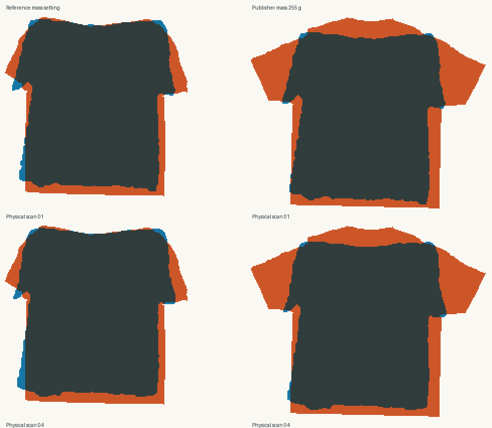

# 从实物点云核对悬挂布面深度

用 RGBench 的真实绿色圆领 T 恤验证同版纸样。平铺输入点云生成纸样和毫米 DXF，另取持续悬挂中的六帧扫描作为实物评分。在原有轮廓和最近点到面距离之外，程序现在从经标定的相机原点向每个测得的布面点投射视线。GLB 的首个交点与实测沿射线距离相减。正值表示预测布面更远离相机。两种模型只在都命中的实测射线上评分，报告各自及共同命中的数量。[原归档、分组及配缝](suspension-study.md) · [RGBench 数据与 CC BY 4.0 许可](https://huggingface.co/datasets/RGBench/RGBench-Cloth-Sim2Real-v1)

## 用早期扫描预测短时摆动

固定两个抓取点的重力仿真提高了正面轮廓重合度，但逐射线看，后段布面落在实测点后方。为检查悬挂摆动的影响，程序仅用三个较早的扫描估计衣身中心的倾角和角速度。先在每个高度区间取布面坐标中位数，再拟合倾角。用等效摆长为可见悬垂长度三分之二的均匀条带近似，得到周期 **1.296 秒**。从结束标定时刻预测之后 **0.72 秒**，绕两个固定抓取点的连线旋转同版 GLB。预测使用早期扫描和目标时间戳。六帧留出扫描的倾角绝对误差中位数为 **0.26°**，最大为 **1.50°**。

| 六帧指标的中位数 | 固定支撑重力仿真 | 加入短时摆动 |
| --- | ---: | ---: |
| 正面轮廓交并比 | 87.08% | 88.23% |
| 沿相机射线的绝对距离中位数 | 22.11 mm | 8.25 mm |
| 沿相机射线的绝对距离 P90 | 54.86 mm | 37.48 mm |
| 沿相机射线的有符号距离中位数 | +18.71 mm | −1.73 mm |

六帧中有 **97.24%–98.57%** 的实测射线命中两种模型。离较高抓取点 **500–600 mm** 的衣身下段，有符号误差中位数从 **+50.69 mm 降至 −1.54 mm**。同一区间的绝对误差 P90 从 **64.00 mm 升至 69.84 mm**。整体摆向的偏差减少了，局部形变还需要验证。这次预测只改变整体朝向，原版型、缝合拓扑和细小褶皱使用同一重力仿真网格。[逐帧射线统计、倾角和来源哈希](measured-depth-study.json)


此实验的直接深度证据属于 RGBench 的双点悬挂 T 恤。馆藏 T 恤的人台对照仍使用照片外包络，两者的姿态条件及真实样衣各自记录。[馆藏人台外包络](drape-support-study.md)

## 记录整衣重量后的对照

RGBench 发布的绿色 T 恤两组网格配置均记录整衣重量 **0.255 kg**。本实验按发布方模型的整衣质量使用，单独的称重原始记录仍缺。Blender 的质量设置按顶点定义。程序把整衣质量均分到同版缝合网格的 **6,848** 个顶点，约 **0.00003724 kg/顶点**。对照版沿用参考求解器默认的 **0.15/顶点**。两版使用相同已校验的纸样和仿真前 GLB，固定支撑、刚度、接触设置、帧数和重力相同。RGBench 在其求解器中拟合的伸长、弯曲和摩擦系数保留在原配置。[发布配置](https://github.com/hwk0809/RGBench/blob/1631f595ecad273c9a56104d183a95b0d9318a9c/configs/cloth_params/green_tshirt_5k.yaml) · [RGBench 的求解器说明](https://github.com/hwk0809/RGBench/blob/main/docs/BENCHMARK.md) · [Blender 质量字段](https://docs.blender.org/api/4.5/bpy.types.ClothSettings.html#bpy.types.ClothSettings.mass)

| 六帧留出指标的中位数 | 参考求解器设置 | 发布方整衣重量 |
| --- | ---: | ---: |
| 正视轮廓交并比 | 87.08% | 74.53% |
| 共同命中射线绝对深度中位数 | 22.10 mm | 10.40 mm |
| 共同命中射线绝对深度 P90 | 54.85 mm | 35.26 mm |
| 仿真最后八帧顶点位移 P90 | 6.45 mm | 2.68 mm |

六帧共同命中率为 **97.30%–98.57%**，深度统计比较同一批射线。只改变质量使布面深度更接近实测，同时使正视轮廓重合下降。整衣质量已接入出档和复核，袖片垂落仍需结合实测弯曲、拉伸及支撑形态验证。



橙色为仿真独有区域，蓝色为实物独有区域，深灰为重叠。按整衣重量计算时，袖子和领肩附近伸出了更多轮廓。实物扫描来自 Hu 等人，许可为 CC BY 4.0。[逐帧指标和网格哈希](rgbench-mass-study.json)

```sh
python -m examples.evaluate_rgbench_material build/rgbench-scan/frames/18-21-20-start/archive \
  build/rgbench-forecast/data/suspension.json -o build/rgbench-mass
```

归档及悬挂参考清单可以用下节命令生成。程序校验发布方配置哈希，`study.json` 保存同版纸样哈希和逐帧指标，两组子目录保留各自 GLB 和用于共同射线评分的原始差值。

## 数据入口核查

已从格拉斯哥大学 CC BY 4.0 的 CloPeMa Clothes 高分辨率档案读取首卷签名和末卷索引，核对 6,073 项条目，其中包括先前实验所用两件 T 恤的第 0 帧 RGB、深度和分割记录。索引列出 PNG、MAT 和目录，未发现单列的标定文件。原始分卷为约 25.77 GB，本次核查使用远程范围读取文件索引。[正式数据档案](https://researchdata.gla.ac.uk/270/)

同校另一个立体服装数据库在论文中列出了每个姿态的相机 XML、视差、掩码以及平铺和悬挂拍摄。已从网页存档找回原发布页的七个数据链接，逐一访问均返回访问限制。论文标明数据用于科学研究。[原始论文](https://arxiv.org/abs/1311.7295) · [历史数据附件页](https://web.archive.org/web/20201010190742id_/https://sites.google.com/site/ugstereodatabase/attachments)

Flat’n’Fold 的目录确认 CC BY 4.0，公开的相机文件和样本说明列出同步正视、侧视和顶视 RGB-D。实际访问代码库所列的共享目录，页面提示链接已过期。校方档案页仍有数据申请入口。ETH Zurich 的 4D-DRESS 具有同步原图、相机参数与实穿扫描，其数据许可限于非商业学术用途，且以所属机构邮箱申请。[Flat’n’Fold 校方档案](https://researchdata.gla.ac.uk/1881/) · [采集文件说明](https://github.com/lipeng-zhuang521/flat-n-fold#dataset) · [4D-DRESS 内容](https://eth-ait.github.io/4d-dress/) · [4D-DRESS 数据许可](https://4d-dress.ait.ethz.ch/)

已下载 Sánchez-Banderas 等人的布样实测表。共 86 条布样，其中 19 条为平纹针织 `jersey`，包含克重、厚度和真实 Cusick 垂坠测量。该布样表可供材料试验复核，未标注与 RGBench 绿色 T 恤相同的面料。[作者发布与数据入口](https://gabrielcirio.gitlab.io/#publications)

## 复现

```sh
python -m examples.evaluate_rgbench_scan --archive -o build/rgbench-scan
python -m examples.evaluate_rgbench_hang build/rgbench-scan/frames/18-21-20-start/archive \
  --forecast-swing -o build/rgbench-forecast
```

输出的 `suspension/comparison.json` 包含校准与评分时间、共同命中率、分高度的误差、每帧的绕轴旋转及其轮廓。基础形状保存在 `gravity-pose.glb`。对其他同件实物点云，可在悬挂对照清单中提供以下字段，再运行 `python -m superarchiveallclo.compare_hang`。时间戳以秒为单位，评分时间与 `reference_scans` 顺序对应。

```json
{
  "support_timestamp": 1.24,
  "swing_history": [
    {"file": "swing-01.pcd", "timestamp": 1.00},
    {"file": "swing-02.pcd", "timestamp": 1.12}
  ],
  "reference_timestamps": [1.36, 1.48]
}
```
