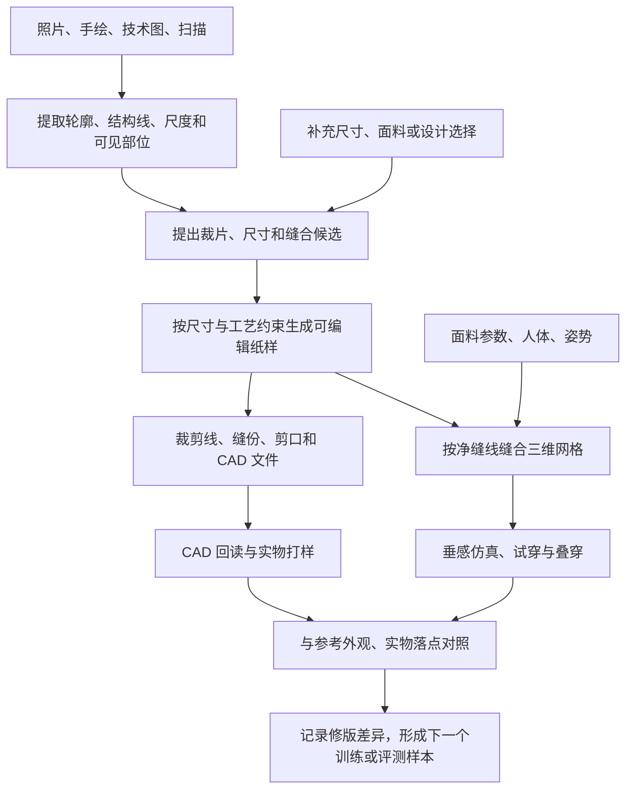

# 模型与系统设计

## 模型预测什么

目标是从外观证据推断一件衣服的构造。以微落肩 T 恤为例，模型要回答前后片、袖片和领条怎样裁，哪些边应当缝在一起，各部位尺寸为何取这个值。二维纸样负责描述衣服展开时的几何，三维求解器计算它在给定材料、人体和重力下的形态。两个视图共享同一件衣服的版次。

## 一件衣服的数据结构

| 对象 | 最少记录的内容 | 为什么需要 |
| --- | --- | --- |
| 款式与版次 | 款式、品类、版次、父版本、基码、单位、测量方法和目标松量 | 区分款式修改、换码和换人体。内部纸样长度统一用 mm |
| 裁片 | 稳定的裁片与边标识、带方向的闭合曲线、净缝线、分段缝份、布纹线、剪口、省道或内部线、镜像/对折、裁剪数量和材料归属 | 同一条边能在二维、缝合表、三维网格与文件回读时对应 |
| 缝合与工艺 | 配对边或子区间、对应方向、对位点、工艺类型、预期吃势或拉伸比；折边、开口单独标注 | 袖山可有吃势，针织领条可短于领口。配缝校验按工艺关系计算 |
| 规格与放码 | 净体与成衣规格分栏，平量或整圈、测量部位、目标公差、放码点与随码变化规则 | 换码时重新计算关联尺寸，允许肩宽、袖窿和衣长采用不同增量 |
| 材质、人体与场景 | 经/纬向或纵/横向拉伸、剪切、弯曲、克重、厚度、摩擦；人体尺寸/网格、姿势、层次及求解器配置 | 保留每个材料参数的实测值、估计范围与单位，每次试穿可以复算 |
| 证据与状态 | 每个关键字段的来源、参考图区域或点云区域、置信度、替代解释、校验结果和人工修改 | 新增背面图时可追溯被修正的结构，并保留已确认的尺寸 |

纸样生成的裁剪线供打版导出，净缝线供缝合求解。改变某条缝边后，重新计算受影响的对位点、缝份和三维网格。每次导出携带相同的款式、版次和尺码标识；试穿还记录人体、面料与姿势。

## 推断、训练和修正

1. **建立可比较的基线。** 从少量标注点、轮廓和已知尺寸拟合一件参数化 T 恤，用约束优化求肩宽、袖肥、衣长等参数。记录输入、误差和人工改动量。后续每个学习模型都在同一批盲测款上与它比较。
2. **训练首个学习模型。** 用成对的图像和纸样训练视觉编码器和参数预测头。首轮固定 T 恤的裁片拓扑，输出尺寸、曲线控制参数、部件可见性与不确定度。手绘和照片使用各自的增强策略，技术图中的尺寸文本经过单位和测量部位核对后进入约束。
3. **扩展到可变结构。** 加入裤装、衬衫和不同袖型后，预测裁片与边的连接关系，再求连续几何。为同一输入保留多个可缝制候选。多视图和扫描特征可补充图像特征；扫描分支记录尺度、人体姿势、表面法线与缺失区域。
4. **让模拟反过来检查纸样。** 候选先过闭合、自交、配缝和尺寸校验。把合格候选穿到对应人体，按可见区域比较多视图轮廓、结构线或扫描表面距离。优先修正证据充分的变量，面料和版型产生相似垂感时保留多解。
5. **训练目标分开量化。** 分别评估裁片/配缝识别、毫米级尺寸、归一化曲线形状、渲染轮廓和置信度。训练时可用确定的合成标签监督，真实修版差异用于后续校准。对缺尺度的照片报告比例和待补尺寸，对置信不足的部位显示可编辑选项。

首个模型的一条训练记录包含输入图、已知尺寸、可见部位掩码，以及目标裁片控制点、配缝和成衣规格。多模态训练时随机隐藏某些输入，同一款的不同视图共享纸样标签。扩展到新结构时，解码器先提出裁片数量和边的配对，再预测每片的曲线参数。训练与推断都用允许的工艺关系屏蔽无效配对，生成的连接图仍可由人改动。

## 输出和交换

| 输出 | 首个实现 | 升级到行业交付 |
| --- | --- | --- |
| 制板 | 可编辑参数与曲线、SVG 和带校准方框的 1∶1 PDF，附测量表、裁片清单及配缝表 | 按目标 CAD 的 DXF-AAMA 或 DXF-ASTM 方言建立导出配置，处理单位、图层、曲线、剪口和放码。逐项回读，并在指定软件版本复验 |
| 三维模拟 | 从纸样三角化，按净缝线缝合，在基准人体上求静态垂感。保留裁片到网格的映射和求解配置 | 引入经测试的面料、动作序列、口袋与多层接触；记录碰撞、穿透和收敛情况 |
| 三维试穿 | 由净体尺寸驱动可复现的人体，换体型后重新求解，显示正侧背视图、部位松量和局部应变 | 加入经授权的人体扫描、姿势及叠穿。用实物数据校准解释范围；绝对压力和舒适度需要单独标定 |

GLB 用于交互查看三维结果，旁附原始纸样、缝合关系、材料与单位换算信息。导出时测试毫米到米的换算和坐标轴，保证同一件衣服在三维查看器、纸样文件和仿真中按同一比例显示。

## 从零得到训练与评测样本

- **自己造配对数据。** 从原创基础纸样改变肩点、衣长、袖口、体型和材料，在合理区间采样。每件衣服一起产出纸样真值、连接关系、尺寸表、正背技术图、多视角渲染和人体姿势。用线稿扰动近似不同画法，用深度与采样噪声生成模拟扫描；这些样本标为合成。
- **尽早接触真实图。** 自愿取手边一件普通 T 恤，在光线和背景不同的条件下拍正背平铺照，按测量示意记录半胸宽和后中衣长。只把实际观察到的项目作为标签。此后把自有纸样缝成样衣再拍摄，就能获得同款的真实照片、正确纸样和修版记录。
- **按款式家族隔离数据。** 同一母版的尺码、配色、视角及增强图放在同一集合，单独留出未见过的版型和真实衣物。只有一个母版时，测试结论限定为该母版内的参数泛化。
- **保留数据来源。** 样本登记生成版本、材料假设、实测方法和可使用范围。真实人体照片、人体扫描及合作方原版如后续出现，按授权存储，公开项目仓库只承载可公开的规划、代码和示例。

初期可用 Python 做几何与基线拟合，用 Blender 的布料仿真和渲染生成第一批配对样本，再用 PyTorch 训练轻量预测头。先统计少量样本的仿真时间、失败率和显存占用，据此决定数据量与算力。首轮架构无需购买商业 CAD、扫描仪或训练服务。

## 可复核的研究参照

- 参数化裁片、缝合关系与配对数据的表示可参照 GarmentCode 和 GarmentCodeData。[官方实现与数据说明](https://github.com/maria-korosteleva/GarmentCode)
- 单图恢复纸样可用 Sewformer 的任务设置设计对照实验。[官方实现](https://github.com/sail-sg/sewformer)
- 多模态设计输入到参数化制板程序可参照 Design2GarmentCode。[官方实现](https://github.com/Style3D/design2garmentcode-impl)

这些项目作为研究对照。实际引入代码、权重或数据时，分别核对对应版本的许可与用途，并记录在数据或依赖清单中。
