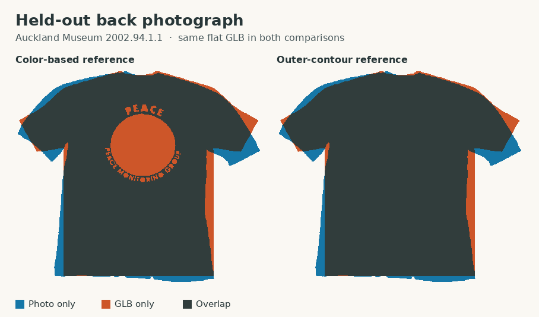

# 两件真实圆领 T 恤的正背照实验

两个样本均来自奥克兰战争纪念博物馆 Tāmaki Paenga Hira，原始照片以 CC BY 4.0 发布。实验冻结原图哈希和模型权重，使用已有的照片推断、制板及仿真程序生成候选 DXF 与同版 GLB。标尺读数、馆藏记录和结构特写是验证证据。未将这些照片或馆方尺寸用于拟合权重。[照片、许可、测点与校验值](../examples/auckland-tees.json) · [CC BY 4.0](https://creativecommons.org/licenses/by/4.0/)

## 藏品 2017.66.22

博物馆记录后中衣长 690 mm、胸宽 515 mm、肩宽 505 mm。实验在正背照片上标出同一条后中长度，主方案从可见的后领连接线量到下摆。程序用 690 mm 定尺度，衣长从评分中排除。估计胸宽和肩宽时，模型只看照片，不接收这两项馆方读数。馆方页面没有描述胸宽和肩宽的取点方式。[馆方尺寸和背面平铺照](https://commons.wikimedia.org/wiki/File:T-shirt,_playing_(AM_2017.66.22-8).jpg) · [正面平铺照](https://commons.wikimedia.org/?curid=83524143)

| 留出的馆方尺寸 | 馆方 | 纸样推断 | 差值 |
| --- | ---: | ---: | ---: |
| 胸宽 | 515.000 mm | 566.893 mm | +51.893 mm |
| 肩宽 | 505.000 mm | 502.682 mm | −2.318 mm |

把定尺度的起点移到可见的后领上缘，同一模型的胸宽误差变为 +31.924 mm，肩宽误差变为 −21.006 mm。两个方案显示了取点口径对毫米误差的影响。主方案在计算误差前固定。

另用袖口内、外侧的两张独立照片核对结构证据。可见袖口翻边和内侧缝线，领条和袖窿接缝也可从平铺照看到。程序随档保存这两张特写。裁片净线、领条原始长度和缝份仍需实物或原版核对。[袖口外侧](https://commons.wikimedia.org/wiki/File:T-shirt,_playing_(AM_2017.66.22-17).jpg) · [袖口内侧](https://commons.wikimedia.org/wiki/File:T-shirt,_playing_(AM_2017.66.22-18).jpg)

## 藏品 2002.94.1.1

正背实拍都包含同一类英寸软尺。各自取 20 到 30 英寸的一段 254 mm 定尺度。沿尺比较 15 到 20 英寸、20 到 30 英寸及 30 到 32 英寸，可见局部比例变化。照片的透视和尺面形变可能影响横向及局部读数。馆方的 `SIZE 20` 是尺码标记，本轮没有用它作成衣实测值。[馆方藏品说明](https://www.aucklandmuseum.com/discover/collections/record/510965) · [带尺正面](https://commons.wikimedia.org/?curid=64330673) · [带尺背面](https://commons.wikimedia.org/?curid=64330689)

| 像素比例 | 正面 | 背面 |
| --- | ---: | ---: |
| 15–20 英寸 | 0.55209 mm/px | 0.56190 mm/px |
| 20–30 英寸 | 0.52263 mm/px | 0.52695 mm/px |
| 30–32 英寸 | 0.51271 mm/px | 0.51826 mm/px |

## 同版纸样的平铺三维与照片对照

两个正背照归档均通过五片毫米 DXF 裁片、十五条接缝和四处开口的回读核查。程序读取同版纸样、缝合平铺 GLB，并将其投影到统一的 2 mm 网格上。袖片使用输入正面可辨认的袖口方向，资料不足时使用预设角度。评分图仅用照片的外轮廓，衣身内与背景同色的印花仍归入服装。对齐只用平移。[机器可读结果、校验及逐视角数据](paired-photo-study.json)

| 档案和对照图 | 轮廓交并比 | 轮廓距离 P90 |
| --- | ---: | ---: |
| 2017.66.22 双面归档对照正面 | 86.44% | 41.07 mm |
| 2017.66.22 双面归档对照背面 | 77.15% | 64.00 mm |
| 2002.94.1.1 双面归档对照正面 | 89.29% | 36.88 mm |
| 2002.94.1.1 双面归档对照背面 | 87.92% | 34.00 mm |
| 2002.94.1.1 单面归档对照留出背面 | 90.93% | 28.00 mm |



图中两次评分使用同一平铺 GLB 和同一留出背面，右图纠正了印花被当作背景的问题。修正后背面轮廓距离 P90 由 172 mm 降到 28 mm。蓝色为实物照片独有区域，橙色为模型独有区域，深灰色为重叠。照片数据来自 Auckland Museum，CC BY 4.0。[原始背面照片](https://commons.wikimedia.org/?curid=64330689)

当前误差衡量照片平面的边界。后续对同件 `2017.66.22` 的挂拍估计了人台上的三维外包络，并用同版纸样量出两种人台的模拟差异。布面深度仍待直接三维测量。馆方胸宽的误差和标尺区间的尺度变化仍限制绝对尺寸的判定。[人台三维对照](mannequin-study.md)

## 复现

```sh
python -m examples.evaluate_auckland_tees -o build/auckland-study
```

每件输出自己的 `study.json`。有馆方测量时，`review/` 记录盲测误差。`flat-layout/` 中有从同版纸样缝合的平铺 GLB、正背叠图和逐视角误差。黄色样本的 `single-front-flat-layout/` 记录留出背面的对照。也可使用 `python -m superarchiveallclo.compare_flat_photos --help` 单独对照已有档案的平铺姿态。
