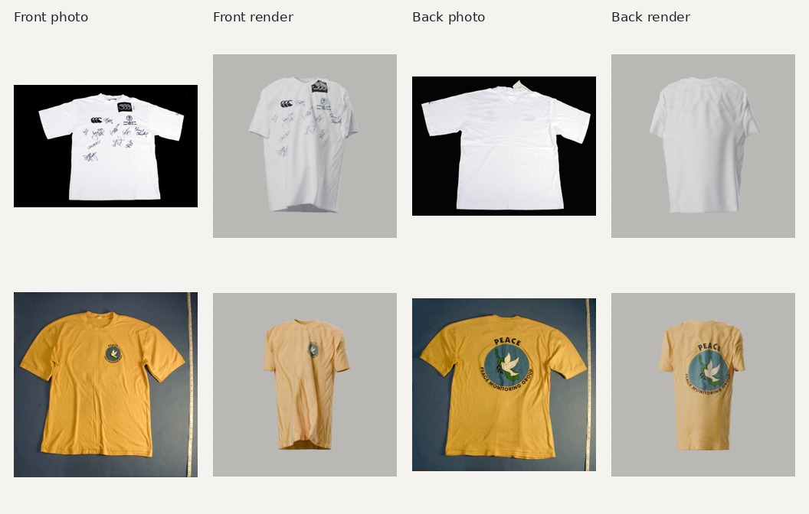

# 从正背实拍恢复衣身外观

同一归档命令从已标定的平铺照预测毫米纸样，并按照片中的肩部、腋下与下摆将衣身图像映射到纸样坐标。布料缝合、变形后仍沿用该坐标。缝线两侧各自保留原裁片所属的图像。裁片坐标和照片坐标都写入可编辑 Blender 工程，GLB 内嵌贴图，可单文件查看。

## 两件实物对照

这两件奥克兰博物馆藏品都独立于合成训练集。程序从白色款正面提取了签名与胸前标记，从黄色款正背面提取了徽章、背面文字和鸽子图案。背面印花朝向与照片一致。下图每行依次为原物正面平铺照、正面渲染、原物背面平铺照、背面渲染。原照片经过缩放排版，来源为 Auckland War Memorial Museum Tāmaki Paenga Hira，采用 CC BY 4.0。[白色正面](https://commons.wikimedia.org/?curid=83524143) · [白色背面](https://commons.wikimedia.org/?curid=83524147) · [黄色正面](https://commons.wikimedia.org/?curid=64330673) · [黄色背面](https://commons.wikimedia.org/?curid=64330689) · [CC BY 4.0](https://creativecommons.org/licenses/by/4.0/)



| 检查 | 白色 2017.66.22 | 黄色 2002.94.1.1 |
| --- | --- | --- |
| 纸样回读 | 5 片毫米 DXF、15 条接缝 | 5 片毫米 DXF、15 条接缝 |
| 同版模拟 | 4 处开口、2 套 UV 坐标 | 4 处开口、2 套 UV 坐标 |
| GLB 内嵌贴图 | 2048 × 1024，逐像素匹配归档图像 | 2048 × 1024，逐像素匹配归档图像 |

白色款使用同一纸样和 38 帧展示人台仿真做有无贴图对照。重新导入两个 GLB 后，顶点位置集合完全相同，均有 149,592 个三角形。对同件留出正面挂拍的轮廓交并比均为 80.11%，轮廓距离 P90 均为 54.23 mm。对应相机下的三维外包络偏差同样一致。白色款纸样胸宽仍偏大 37.38 mm，肩宽偏小 2.32 mm。[毫米误差和拍摄标定](body-profile-study.md) · [挂拍外包络](drape-support-study.md) · [输出哈希与几何对照](photo-appearance-study.json)

照片 RGB 自带光照、阴影和折痕。领条和袖片用取样色，印花目前映射前、后衣身。面料表面反射、布料伸长、局部图案的毫米位置和真实穿着形变仍需实物参考。图中的平铺照片和 3D 采用不同姿态。

## 复现

先用[衣身宽度实验](body-profile-study.md#复现)准备两份原始采集和白色款挂拍参考，然后运行：

```sh
python -m superarchiveallclo.capture build/auckland-profile/netball/data/paired.json \
  --model models/tee-vision.npz --blind --form display_torso --photo-appearance -o build/appearance-netball
python -m superarchiveallclo.capture build/auckland-profile/peace/data/paired.json \
  --model models/tee-vision.npz --blind --form display_torso --photo-appearance -o build/appearance-peace
python -m superarchiveallclo.check_archive build/appearance-netball
python -m superarchiveallclo.check_archive build/appearance-peace
python -m superarchiveallclo.visual_hull build/appearance-netball \
  build/auckland-profile/netball/drape/data/hull-reference.json -o build/appearance-hull
```

用同一条白色款命令生成去掉 `--photo-appearance` 的对照归档，然后将其传给 `visual_hull`。用 Blender 打开 `model/garment.blend` 可检查两个 UV 图层和打包的 PNG。Web 预览可直接使用 `model/garment.glb`。
