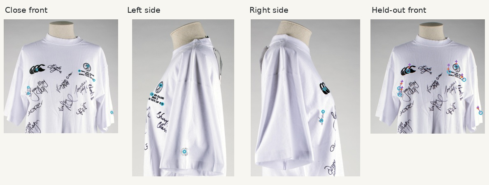
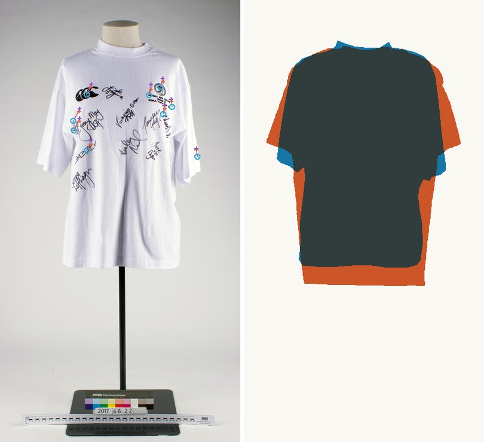

# 同件圆领 T 恤的照片制板与局部三维评测

以奥克兰博物馆藏品 `2017.66.22` 为样本。从正、背平铺照估计毫米纸样，用同一纸样生成可编辑 Blender 工程和带照片贴图的 GLB。平铺照用馆方记录的 690 mm 后中衣长定尺度，该尺寸从独立评分中排除。实际制板使用固定的合成训练权重，馆方胸宽与肩宽只在评分时读取。两张袖口特写保留了翻边和内缝证据。照片来自 Auckland War Memorial Museum Tāmaki Paenga Hira，采用 CC BY 4.0。[实拍与馆方尺寸](paired-photo-study.md) · [衣身宽度误差](body-profile-study.md) · [CC BY 4.0](https://creativecommons.org/licenses/by/4.0/)

| 独立尺寸 | 实物 | 纸样候选 | 纸样减实物 |
| --- | ---: | ---: | ---: |
| 平铺胸宽 | 515 mm | 552.38 mm | +37.38 mm |
| 肩宽 | 505 mm | 502.68 mm | −2.32 mm |

归档回读检查通过 5 片毫米 DXF、15 条接缝、4 处成衣开口及 GLB 内嵌图像。按馆方原照片的内、外袖口核对到翻边和内缝。净裁剪线、缝份尺寸及伸长仍需独立打样验证。

## 用同一姿态的挂拍量局部三维

从近正面及左右侧面的实物挂拍上，标记了同一印花、签名的局部点和一处袖口标记。每个点由近正面与其中一张侧视计算三维位置。标注和挂拍全部独立于候选纸样输入，GLB 在同一颈顶基准下只做平移。程序计算照片三维点到导出 GLB 三角面的最近距离。以下为首轮七点及一张留出图的结果。[原挂拍及比例尺](mannequin-study.md) · [首轮各点与输出哈希](photo-landmark-study.json)



图中青色圆圈是人工标注。留出正面上橙色十字为正交近似的反投影，紫色为用相机 EXIF 焦距的针孔近似。照片已裁切、缩放并叠加标记，原图采用 CC BY 4.0。[原图位置与授权清单](../examples/auckland-drape.json)

| 同一纸样的仿真 | 7 点到模型的正交中位数 | 正交 P90 | EXIF 针孔中位数 |
| --- | ---: | ---: | ---: |
| 带臂人台、38 帧 | 15.16 mm | 23.09 mm | 7.71 mm |
| 无臂人台肩部固定、38 帧 | 7.27 mm | 17.30 mm | 6.68 mm |
| 无臂人台接触支撑、38 帧 | 7.57 mm | 19.43 mm | 7.37 mm |
| 无臂人台接触支撑、76 帧 | 5.57 mm | 18.65 mm | 5.14 mm |

主方案使用 38 帧接触支撑。四张用于构造外包络的挂拍和额外留出照对该 GLB 给出 **80.11%** 留出轮廓交并比和 **54.23 mm** 的轮廓距离 P90。局部距离只覆盖上胸与一只袖口。两种镜头近似对相同标记得出的三维位置可相差 **15.27 mm**，独立正面上的反投影偏差中位数分别为 **17.33 mm** 和 **28.87 mm**，以基准平面的像素尺度换算。相机姿态和布面误差会共同影响这些数值。直接扫描、下半段布面和真实面料参数仍待核对。[各点位置、模型哈希与误差](photo-landmark-study.json)

### 第二张留出挂拍

同一件 `2017.66.22` 的 #20 原先只用两把实体尺和立杆定尺度。本轮单独标注该图的衣物轮廓，并用实际照片匹配 #01 的标记位置。两张照片的衣物像素均留出，制板、三角测量和外包络仍用原输入。新增左右衣身中段的两个墨迹点，合计九点，仍保留袖口点。[原照及视角角色](../examples/auckland-drape.json) · [九点像素坐标](../examples/auckland-landmarks.json)

| 照片模型 | 九点到 GLB 的距离中位数 | 两张留出照片的反投影中位数 | 每张照片均通过 25 mm 的点 | 通过点的距离中位数 |
| --- | ---: | ---: | ---: | ---: |
| 正交近似 | 9.44 mm | 17.86 mm | 6/9 | 12.18 mm |
| EXIF 针孔近似 | 7.08 mm | 29.70 mm | 1/9 | 7.37 mm |

25 mm 是本次报告的单点反投影限值，使用各画面的基准平面换算，拟合照片和留出照片都须通过。它用于揭示相机近似带来的误差，绝对深度仍需独立扫描。正交近似下，三个点只在第二张留出图超过限值。两处新增衣身点均通过，到 GLB 的距离中位数为 10.27 mm。固定相机时，约 1 mm 的三维坐标灵敏度对应 1 像素差，相机位置本身引入的误差明显更大。

同版 GLB 在 #20 上的轮廓交并比为 **83.98%**，轮廓距离 P90 为 **53.43 mm**。在 #01 上分别为 **80.11%** 和 **54.23 mm**。局部点和整体轮廓一起报告，验证覆盖衣身上段、中段与一处袖口。下半段与背面的局部布面几何仍缺可独立复核的点。



左图青圈为留出照片的点位，橙色和紫色为两种相机的反投影。右图橙色仅为模型覆盖，蓝色仅为实物覆盖，深灰为两者重叠。照片由 Auckland War Memorial Museum Tāmaki Paenga Hira 以 CC BY 4.0 发布，此处裁切原图并添加标记。[原照](https://commons.wikimedia.org/?curid=83524175) · [许可](https://creativecommons.org/licenses/by/4.0/)

## 复现

```sh
python -m examples.evaluate_auckland_archive --reprojection-limit-mm 25 -o build/auckland-end-to-end
```

命令从馆方发布源下载并核对全部照片，保存输入、尺寸盲测、完整归档、相机尺度、外包络和局部点报告。总表在 `build/auckland-end-to-end/evidence.json`，交付件在 `review/archive/`。运行需要 Blender，实验使用 4.3.2。

对已有归档，可直接使用 `photo_points`。参考清单沿用 `visual_hull` 的来源哈希、视角、像素尺度和模型基准，点位评测可直接读取原图。点位清单为每个点提供用于拟合的正面或背面与侧面坐标，以及单独的留出图坐标。EXIF 针孔对照可通过 `exif_focal_plane_axes` 启用。

```sh
python -m superarchiveallclo.photo_points build/auckland-end-to-end/review/archive \
  build/auckland-end-to-end/reference/hull-reference.json examples/auckland-landmarks.json \
  --reprojection-limit-mm 25 -o build/auckland-local-check
```

ClothPose 论文介绍了带相机标定的 RGB-D 和多角度实物扫描。已核对公开代码树中的实际文件，随代码发布的是连衣裙点云和拟合示例。全量数据入口仍标为准备发布。[ClothPose 论文](https://openaccess.thecvf.com/content/ICCV2023/html/Xu_ClothPose_A_Real-world_Benchmark_for_Visual_Analysis_of_Garment_Pose_ICCV_2023_paper.html) · [官方发布状态](https://github.com/dwxrycb123/ClothPose#dataset)
