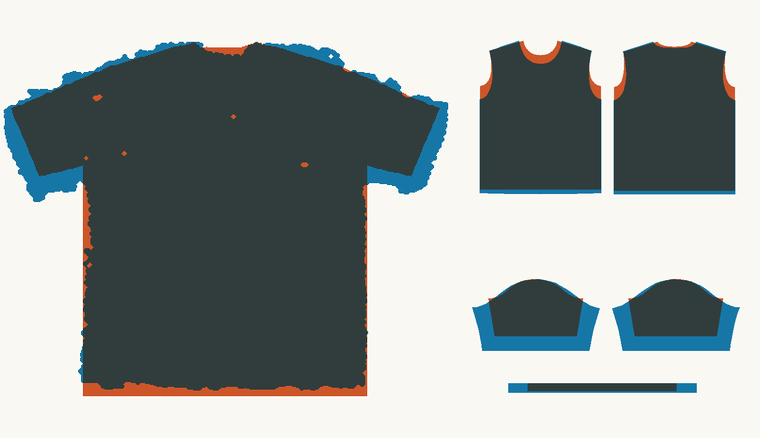

# 实物扫描与裁片对照

这次用第一个 RGBench 平铺帧生成的候选归档，比对同件 T 恤另外八帧的实物点云，以及数据集中与其配套的 Style3D 模拟参考网格 `green_tshirt_5k.obj`。所有对照使用原归档纸样。报告保存原始点云、参考 OBJ、生成纸样与平铺 GLB 的哈希。[实验数据与 CC BY 4.0 许可](https://huggingface.co/datasets/RGBench/RGBench-Cloth-Sim2Real-v1) · [RGBench 数据文档](https://github.com/hwk0809/RGBench/blob/main/docs/DATASET.md)



蓝色表示仅参考覆盖，橙色表示仅候选覆盖，深灰表示重叠。左侧叠图采用独立复拍点云。右侧从上到下分别为前后衣身、双袖及领条，参考来自 RGBench 的 Style3D 网格。右侧各裁片分别缩放显示，数值使用报告中的毫米尺度。图中参考数据来自 Hu 等人，CC BY 4.0。[完整对照报告](real-reference-comparison.json)

## 平铺三维

程序把已归档纸样缝合为同边共享顶点的平铺网格，上下衣层的名义间距为 2 mm，袖向采用预设的向下 23°。用 Blender 回读新导出的平铺 GLB，以实际三角面计算实物点到表面的距离，并计算俯视轮廓重合。尺度没有拟合，扫描和网格只做平移对齐。

| 八帧实物复拍 | 结果范围 |
| --- | ---: |
| 俯视轮廓交并比 | 88.6%–91.2% |
| 点到网格表面距离 P90 | 7.73–8.94 mm |
| 双向轮廓边缘距离 P90 | 30.00–37.95 mm |

点到面距离主要覆盖可见内部表面。轮廓指标同时反映袖口、领口和外边缘的偏差，尤其能发现二维投影超出实物而点到面距离较小的情形。此处评估受支撑平铺姿态。人体试穿垂坠、材料与不可见表面需要额外对照。

## 数字裁片参考

Style3D 网格包含五个互不相连的 UV 裁片。程序利用参考网格边长建立毫米尺度，衣身和袖片的边长比中位数为 540.84 mm/UV。几何对齐使用平移，保留尺寸偏差。裁片共享的三维边证明了七组跨裁片连接，与候选纸样一致。领条采用候选的折叠投影作为比较几何，领条拉伸率、自身接缝、缝份与剪口仍需独立证据。

| 裁片 | 净线轮廓交并比 | 候选宽差 | 候选高差 |
| --- | ---: | ---: | ---: |
| 前衣身 | 92.3% | −5.84 mm | −23.02 mm |
| 后衣身 | 94.1% | −5.86 mm | −18.73 mm |
| 左、右袖 | 61.4%、61.3% | −125.77 mm | −56.27 mm |
| 折叠领条 | 65.9% | −98.44 mm | −4.96 mm |

袖片和领条是后续重建精度的主要缺口。这里的差值以作者的配套数字网格为参考。原实物的卷尺尺寸、背面照片及纸样净线仍有待直接验证。

## 复现

```sh
python -m examples.evaluate_rgbench_scan --compare-references \
  -o build/rgbench-reference-reproduction
```

`flat-comparison/` 保存平铺 GLB、逐帧轮廓和距离报告。`pattern-comparison/` 保存五片裁片的叠图与尺寸差。两个比较也可独立运行，对应命令为 `python -m superarchiveallclo.compare_flat --help` 与 `python -m superarchiveallclo.compare_pattern --help`。
