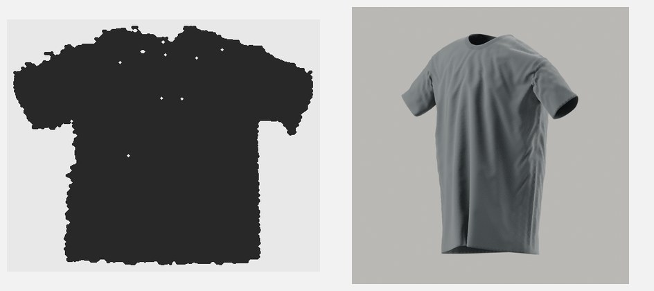

# 真实圆领 T 恤的单面重建

使用 Hu 等人发布的 RGBench 实物数据。`green_tshirt` 由 Intel RealSense D455 拍摄。选用三个折叠序列中仍然平铺的九个帧，以首帧为重建输入，其他八帧为同件复拍对照。实验将镜头可见的一面作为正面输入，数据没有提供可核对的正背面标签。固定数据版本、帧路径、点云及相机变换的哈希记录在 [实验报告](real-scan-study.json) 中。[RGBench 数据与 CC BY 4.0 许可](https://huggingface.co/datasets/RGBench/RGBench-Cloth-Sim2Real-v1) · [Hu 等人，AAAI 2026](https://rgbench.github.io/)



左侧为实物点云生成的平铺投影，右侧为候选纸样在参考人体上的 Blender 垂坠。点云来源为 RGBench，许可为 CC BY 4.0。图中使用参考织物材质，两侧展示的姿态不同。

## 实物实验

程序将已分割的米制点云转换为每像素 2 mm 的正投影，检查平铺程度并保存原始 PCD 和相机外参。单面模型预测制板参数。从实物轮廓直接读取的下段衣身宽及肩顶到下摆距离约束模型的衣身尺寸。当前直身版取下段可见宽度作为胸宽近似值。后领深来自训练先验，结合可见衣身高度推算后中衣长。尺寸记录标明了各自来源。

| 可见尺寸 | 八张复拍范围 | 纯回归中位绝对差 | 使用扫描约束后 |
| --- | ---: | ---: | ---: |
| 下段衣身宽 | 595–606 mm | 49.64 mm | 2.50 mm |
| 肩顶水平线到下摆 | 728–738 mm | 77.18 mm | 12.00 mm |

表中数值比较同一件衣服的重复扫描，采用相同的点云轮廓量法。胸宽、后中衣长、袖窿、领口与纸样结构还需独立实测。真实点云未参与权重训练，首帧实物对照用于确定混合量测方法。各帧可能受铺放变化、轻微褶皱与深度缺失影响。

程序按首帧生成五片裁片、十五条配缝记录、DXF、SVG、A4 PDF、GLB 和 Blender 项目。回读确认 DXF 单位为毫米，3D 与纸样的源哈希匹配，缝合表面保留四个应有开口。模拟使用参考人体与针织参数。实物背面、面料和同姿态 3D 的对照待补齐。

## 复现

安装项目依赖。有 Blender 4.3 或更新版本时，可以一条命令下载九帧、复核尺寸并生成首帧归档。

```sh
python -m examples.evaluate_rgbench_scan --archive -o build/rgbench-reproduction
```

复拍报告在 `build/rgbench-reproduction/study.json`，制板和 3D 在 `frames/18-21-20-start/archive/`。省略 `--archive` 时只生成投影和尺寸报告，可以在没有 Blender 时运行。

已有分割好的平铺 PCD 时，记录扫描来源，按实际采集坐标系指定图像向右、向下的轴。可通过 `--world-to-camera` 提供相机外参。默认以米读取 XYZ，支持未压缩 PCD 和 ASCII PCD。相机原始未分割点云需要先提取衣服表面。

```sh
python -m superarchiveallclo.scan front.pcd --world-to-camera extrinsics.json \
  --right y --down x --item-id tee-001 --source '已标定的平铺扫描' \
  --model models/tee-vision-front.npz -o build/tee-001-scan
```

单面权重可用 `python -m superarchiveallclo.train_vision --front-only --weights build/tee-vision-front.npz --report build/tee-vision-front-evaluation.json` 重训。训练使用 960 件程序生成的正面轮廓，200 件独立合成盲测件用于报告尺寸误差。[权重评估](../models/tee-vision-front-evaluation.json)
