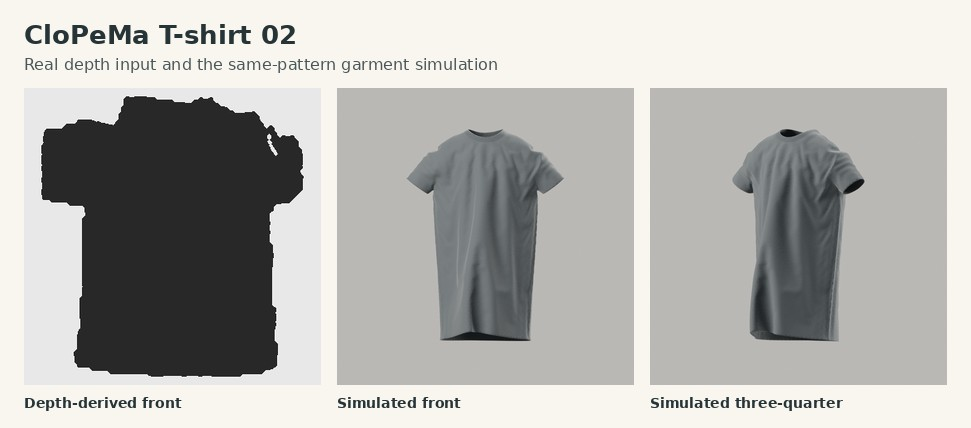

# 注册深度输入与真实 T 恤实验

程序使用已对齐的彩照和光轴深度，按相机内参反投影为三维点。由服装周边的背景深度拟合台面，再按固定毫米分辨率生成俯视图。单面或双面投影可走原有制板流程。采集记录保留内参、深度有效率、台面拟合残差和原始颜色、深度及分割图校验值。训练和测试分组同时核查原始颜色和深度的哈希，同一份采集即使重新投影也不能跨集合。

## CloPeMa Clothes 实物记录

使用 `02` 和 `05` 两件圆领 T 恤的平铺帧 `0`。下载包提供 640 × 480 RGB、16 位深度和多标签分割图，两帧的标签 `2` 对应服装。其余配置主要为皱褶或折叠，抽查的同件帧中没有第二张平铺背面。公开 Kinect 归档没有发现该设备的独立内参文件，原始像素深度按毫米解释。基于标称水平 58° 和垂直 45° 视场计算焦距，并另以 525 px 重算 `02` 的读数，两组均假定主点居中。[数据及 CC BY 4.0 许可](https://researchdata.gla.ac.uk/270/) · [原始论文](https://arxiv.org/abs/1707.07157) · [设备视场规格](https://www.tekwind.co.jp/ASU/products/entry_8483.php)



左图来自格拉斯哥大学实物深度，按标称视场投影，中图和右图是同一候选纸样的 Blender 预览。三图独立取景。实物数据来自 Sun 与 Aragon-Camarasa，CC BY 4.0。

| 同一帧的俯视读数 | 标称视场 | 525 px 焦距假设 |
| --- | ---: | ---: |
| 外包围宽 × 高 | 632 × 676 mm | 694 × 744 mm |
| 下半身宽度代理值 | 467 mm | 512 mm |
| 台面残差 P90 | 3.62 mm | 3.62 mm |
| 有效前景深度覆盖 | 100% | 100% |

两次计算的台面残差相同，衣身宽度差 45 mm。台面拟合检验平整度，对相机内参的绝对尺度没有独立证明力。该样本用于检验真实 RGB-D 输入与制板的连通性。达到实物毫米验收仍需要相机标定文件或独立量测。

## 训练范围与制板

单面权重的原训练记录主要覆盖宽松短袖，按标称视场得到的 632 mm 投影宽度低于其输入范围。新的可选权重加入了衣身更窄和袖长更短的合成版型，训练时用同一套袖山净线检查其与袖窿的配缝。模型从单面可见轮廓推断纸样。袖口和下摆皱褶会影响可见轮廓，背面领深仍用模型先验。[训练日志](../models/tee-vision-front-compact-evaluation.json)

同一可选权重为 `02` 和 `05` 生成了毫米 DXF 及 Blender、GLB。各自通过五片裁片、十五条接缝、四处开口和原始图像、深度、掩码的哈希核查。`02` 的袖口轮廓不足以确认袖长，袖山配缝求解将候选袖长从 120.087 mm 延至 133.421 mm，报告保留两值。`05` 的投影外包围为 592 × 608 mm，衣身宽度代理值为 418 mm。两件的报告均保留标称尺度和单面证据的来源。相同姿态的实物 3D、独立尺寸和结构证据仍待核对。[两件归档和来源哈希](rgbd-study.json)

## 复现

以下命令仅提取指定真实样本。原始下载约 1.2 GB，校验值记录在实验 JSON 中。归档需要 Blender。

```sh
mkdir -p build/clopema-input
curl -fL https://researchdata.gla.ac.uk/270/6/clothes_dataset_kinect.7z \
  -o build/clopema-input/clothes_dataset_kinect.7z
7z e -obuild/clopema-input build/clopema-input/clothes_dataset_kinect.7z \
  'clothes_dataset_kinect/02/clothes_2_capture_0_*.png' \
  'clothes_dataset_kinect/05/clothes_5_capture_0_*.png'
cp examples/clopema-tee-rgbd.json build/clopema-input/input.json
python -m superarchiveallclo.rgbd build/clopema-input/input.json \
  --model models/tee-vision-front-compact.npz -o build/clopema-result
python -m superarchiveallclo.check_archive build/clopema-result/archive
```

把同一采集记录的 `fx` 和 `fy` 都改为 `525`，另指定输出目录，省略 `--model`，即可复现焦距敏感性读数。

复跑第二件时，把 `item_id` 改为 `clopema-05`，将来源编号及每个输入文件名中的服装编号分别改为 `05` 和 `5`，另指定输出目录。

可用固定随机种子重新训练可选权重。

```sh
python -m superarchiveallclo.train_vision --front-only --compact-sleeves \
  --weights build/tee-vision-front-compact.npz \
  --report build/tee-vision-front-compact-evaluation.json
```
