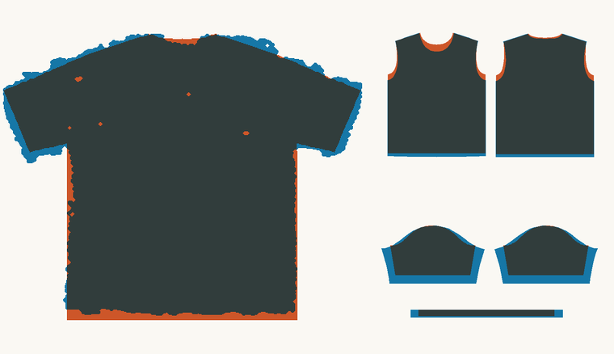

# 从扫描量取袖口与领口

本文记录提交 `1819516` 的结果，可在该版本复现。[新版腋下交点与袖山约束](sleeve-join-study.md)

米制平铺扫描增加了袖口和领口的几何测量。袖口由外缘找到上下端，再用两侧长度估计对称纸样的袖口周长。袖片宽度保留学得的袖口与上臂宽差，袖长结合袖口方向和估计的肩点计算。候选袖片通过袖山和袖窿配缝校验后才采用。领口从衣肩两侧和中央凹口交叉核对。满足条件时，用可见领口宽和标称领条宽推算净领口宽。折叠、遮挡或不对称会保留学得的参数。

归档记录原图裁切区域内以毫米计的端点、两侧袖口长度、拟合残差、领口检测结果和每项约束的来源。袖口周长、袖山与领条仍依赖当前对称版型和材料先验。

## RGBench 实物对照

沿用同一输入帧、八个复拍对照帧和原有 Style3D 数字参考。更新前后的归档使用相同训练权重。从 RGBench 作者用于定位的三维点中，按空间位置辨识两组袖口端点作为独立标注。自动量出的两侧折平袖口与其直线距离相差 **4.93 mm** 与 **13.90 mm**。九帧中有八帧检出双袖口，三帧领口轮廓通过两项检查。[数据与 CC BY 4.0 许可](https://huggingface.co/datasets/RGBench/RGBench-Cloth-Sim2Real-v1)



蓝色是参考独有区域，橙色是候选独有区域，深灰为重叠。右侧裁片分别缩放显示，报告保留毫米尺寸。参考数据来自 Hu 等人，许可为 CC BY 4.0。[本轮指标及数据哈希](scan-landmark-study.json) · [基线报告](real-reference-comparison.md)

| 指标 | 更新前 | 更新后 |
| --- | ---: | ---: |
| 平铺俯视轮廓交并比，八帧中位数 | 90.2% | 92.0% |
| 平铺点到面距离 P90，八帧中位数 | 8.48 mm | 7.83 mm |
| 平铺边缘距离 P90，八帧中位数 | 32.56 mm | 23.49 mm |
| 左、右袖片与数字参考净线交并比 | 61.4%、61.3% | 71.5%、71.5% |
| 折叠领条与数字参考交并比 | 65.9% | 74.4% |

新版袖片比配套数字参考窄 **86.33 mm**、短 **40.49 mm**。领条参考展开长度仍相差 **49.64 mm**。这一件的实物平铺对照用于诊断，后续还要在独立服装上验证泛化，并比对有标准正背实拍、物理纸样或卷尺记录以及同姿态试穿的原件。

## 已知尺寸的合成校验

用 160 个合成轮廓改变袖向、分辨率、尺寸和旋转。折平袖口检出 157 个，P90 绝对误差为 **1.12 mm**。可见领口宽通过检查 159 个，P90 为 **14.25 mm**。这项校验衡量已知轮廓上的观察误差，纸样尺寸仍由实物与数字参考对照报告评价。

```sh
python -m examples.evaluate_flat_landmarks
python -m examples.evaluate_rgbench_scan --compare-references -o build/rgbench-landmark-reproduction
```

实物报告在 `study.json`。其下 `flat-comparison/`、`pattern-comparison/` 与 `frames/18-21-20-start/archive/` 保存重建和对照。历史基线使用提交 `b4b4cc3` 中的同一重建命令复现。
