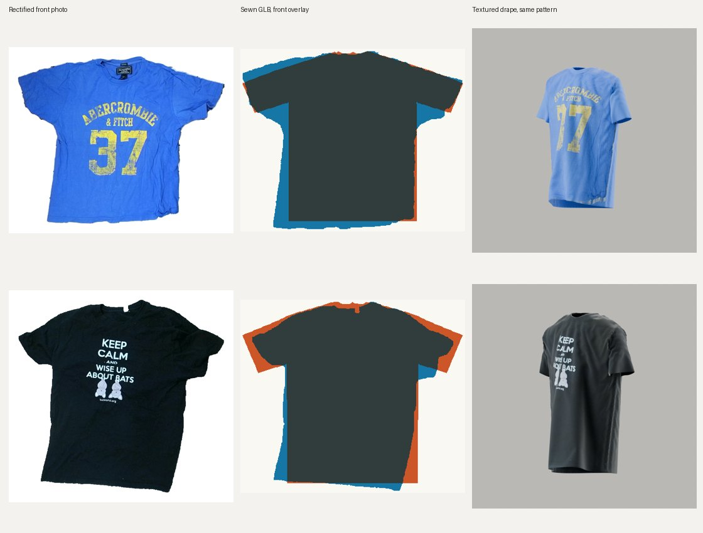

# 二手 T 恤正背照的独立尺度与归档

瑞典 Second-Hand Fashion Dataset v3 按实物编号配对正、背面照片。取两件单层圆领短袖，分别为蓝色男款 `2023_04_11_12_20_04` 和黑色中性款 `2024_04_30_06_56_56`。发布方将台面方格标为 100 × 100 mm，原有标签提供款式和面料成分。这两件用于评测固定权重。[Farrukh Nauman、RISE、Wargön Innovation AB 和 Myrorna AB 发布的数据](https://zenodo.org/records/13788681) · [CC BY 4.0](https://creativecommons.org/licenses/by/4.0/)

## 方格标定

每套相机安装预先记录格线在图像边缘的大致位置。程序对每张原照独立检测格线，在四个实际交点上拟合透视变换，再在同张照片的另外十二个交点测量残差。留出点包含共享边线的交点和四个内部交点。整个尺度由台面提供。正、背照分别矫正，同时按台面已知的摆放方向转正领口。程序从灰色网格背景自动分离深色或高饱和衣服，并保存原照、掩码、参考角点和变换。

| 样本 | 正面留出格点距离 P90 | 背面留出格点距离 P90 |
| --- | ---: | ---: |
| 蓝色男款 | 1.40 mm | 1.50 mm |
| 黑色中性款 | 1.51 mm | 1.61 mm |

这是台面平面内的标定误差。衣服的皱褶、正背翻面后的展开差异以及分割都会影响接缝位置和成衣尺寸。浅色、反光、复杂花纹和背景接近的服装仍需使用独立轮廓图或再次验证分割。

## 纸样与同版三维

窄身双面权重在两件实物上都生成 5 片毫米 DXF、15 条配缝及带实拍贴图的 GLB，并通过归档回读。衣服翻面后的全宽相差 34.82 mm 和 22.60 mm，衣长方向的外轮廓分别相差 6.00 mm 和 9.53 mm。黑色款从正面单独推得胸宽 484.86 mm，留出的背照腋下投影为 455.29 mm，差 29.57 mm。两张实拍本身的胸宽投影相差 29.07 mm，下摆相差 38.66 mm。蓝色款的背照缺少足够稳定的腋下轮廓，因此只报告外宽和外高。两个样本都需要实物卷尺读数确认平量胸宽。

| 样本 | 候选胸宽 | 候选后中衣长 | 平铺 GLB 与正面轮廓交并比／距离 P90 | 平铺 GLB 与背面轮廓交并比／距离 P90 |
| --- | ---: | ---: | ---: | ---: |
| 蓝色男款 | 448.71 mm | 577.31 mm | 87.27%／38.47 mm | 88.67%／32.06 mm |
| 黑色中性款 | 485.80 mm | 657.65 mm | 87.99%／34.93 mm | 92.48%／20.47 mm |

标准双面权重在蓝色款上的袖片和袖窿无法配缝，黑色款可以归档。黑色款用标准权重得到 89.03% 和 94.22% 的正背轮廓交并比，分别高于窄身权重。上表使用同一个预先训练的窄身模型重跑两件，保留不同权重在不同外形上的实测差异。[逐件记录、来源和校验哈希](secondhand-grid-study.json)



左列是矫正并去除网格背景的原照。中列蓝色为实物覆盖、橙色为模型覆盖、深灰为重叠。右列为同版裁片缝合后的布料仿真。照片采用 CC BY 4.0，本图包含裁切、透视矫正和贴图改编。轮廓对照使用参与重建的实拍。挂姿、深度、净裁剪线、缝份和面料力学仍需与独立实物数据核对。[原图发布与许可](https://zenodo.org/records/13788681)

## 运行

```sh
python -m examples.evaluate_secondhand_grid -o build/secondhand-grid
python -m superarchiveallclo.check_archive build/secondhand-grid/blue/archive
python -m superarchiveallclo.check_archive build/secondhand-grid/black/archive
```

程序只从 ZIP 下载指定的原始正背照和记录，核对成员名、文件位置及内容哈希。每件的 `evidence.json` 保存方格、成衣投影、候选尺寸、所用权重和文件校验。输出目录中保留毫米 DXF、同版贴图 GLB、可编辑 Blender 工程以及平铺轮廓对照。可用 `--case blue` 或 `--case black` 单独执行。
