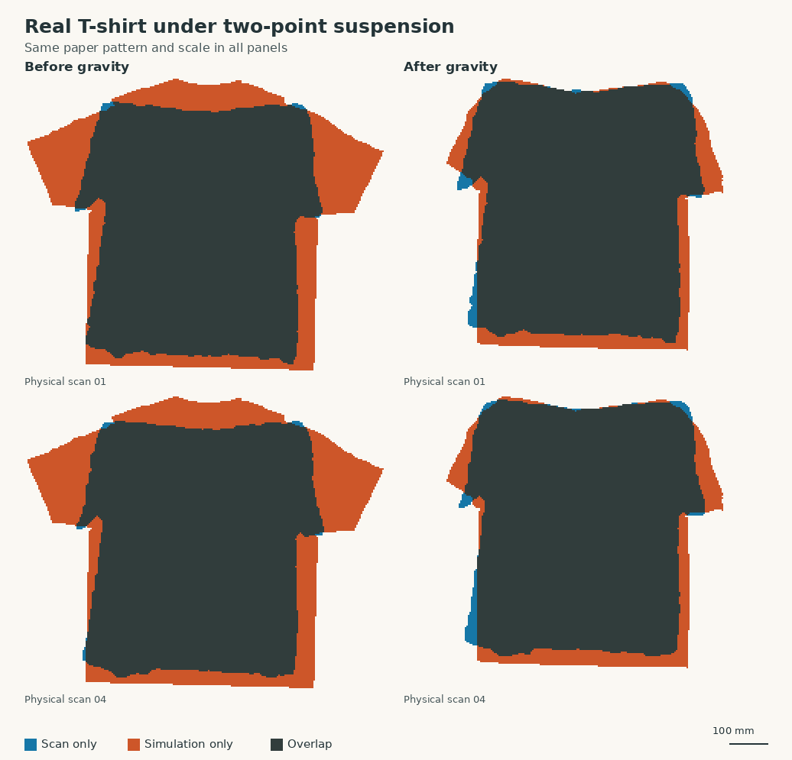

# 实物圆领 T 恤的双点悬挂对照

程序从 RGBench 的一帧标定平铺点云生成毫米纸样，再把同版裁片缝合为可悬挂的网格。归档回读通过五片 DXF 裁片、十五条接缝和四处成衣开口的核查。悬挂实验另用机器人抓取序列，记录原件被提起后与 GLB 在同一世界坐标下的误差。[RGBench 数据及 CC BY 4.0 许可](https://huggingface.co/datasets/RGBench/RGBench-Cloth-Sim2Real-v1) · [纸样净线的单独对照](sleeve-join-study.md)



图中从同一正视方向叠加第 1 帧和第 4 帧的实物投影及仿真。蓝色为实物独有区域，橙色为仿真独有区域，深灰为重叠。参考扫描来自 Hu 等人，CC BY 4.0。

## 支撑与评分

在机器人抓取序列中，从提起前的静置扫描和抓手闭合位置估计布料上的两个抓取区域。从一张单独的悬挂标定帧估计两个绝对支撑位置，取各机器人腕部横向邻域内可见布面最高 3% 的点的坐标中位数。布片受力点未经接触测量，右腕在闭合时离所用可见布面像素的水平距离约 25 mm。模型用刚体变换安放，再让局部网格贴合支撑。两处固定区域各有五个顶点，目标间距 459.12 mm，未对纸样做全局缩放。

从标定帧之后取六帧评分，间隔约 0.12 秒。评分时没有使用这些帧再次配准、调整支撑或估计面料。Blender 回读两个 GLB，按实物点到网格三角面的最短距离统计三维误差。正视轮廓在 4 mm 网格取交并比。表中值先逐帧计算，再取六帧中位数。[逐帧结果、校验哈希与标定细节](suspension-study.json)

| 实物对照指标 | 重力前 | 重力后 |
| --- | ---: | ---: |
| 正视轮廓交并比 | 73.73% | 87.08% |
| 可见点到三角面距离中位数 | 21.11 mm | 17.19 mm |
| 可见点到三角面距离 P90 | 45.42 mm | 47.77 mm |

固定支撑下，袖片垂落和肩部轮廓更接近实物，三维误差的高值略增。六帧内左右腕相对标定帧最多移动 1.41 mm 和 13.30 mm，而其余实物帧与第 1 帧之间的双向最近点距离 P90 为 29.63–57.29 mm。该指标也受扫描可见范围影响。仿真第 47 到 55 帧间的顶点位移 P90 为 6.45 mm。实验量化的是固定双点支撑仿真与仍在摆动的实物的形状差异。逐帧支撑与夹爪接触、面料实测、人体试穿和正背面纸样盲测仍需验证。

## 复现

```sh
python -m examples.evaluate_rgbench_scan --archive -o build/rgbench-suspension-reproduction
python -m examples.evaluate_rgbench_hang \
  build/rgbench-suspension-reproduction/frames/18-21-20-start/archive \
  -o build/rgbench-suspension-reproduction
```

`suspension/` 包含 `before-gravity.glb`、`gravity-pose.glb`、逐帧叠图和 `comparison.json`。`data/suspension.json` 记录输入、标定和评分帧的分工。已有另一件服装的毫米归档、世界标定和支撑证据时，可用 `python -m superarchiveallclo.compare_hang --help` 查看通用入口。
