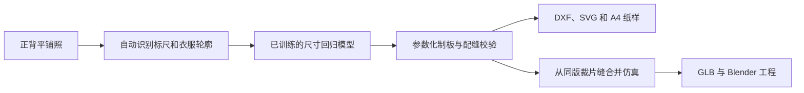

# 圆领 T 恤的照片到纸样模型

## 从两张照片到归档



镜头垂直向下，衣服与标定卡放在同一平面，背景平整且与衣服明暗反差明显。摊开衣身及左右袖，完整拍下正背面。用 100% 比例打印并剪下品红色方块，实测边长 100 mm 后放在衣服旁边。每张图保留一个完整方块，并留出背景边界。[100 mm 标定卡](../examples/calibration-card.pdf)

采集文件只需要照片路径和款式类型。改变 `kind` 为 `physical` 后使用实拍文件。按 README 的归档命令调用模型，无须填写尺寸或标注像素点。[无人工尺寸的样例](../examples/vision-demo/session.json)

当同一件衣服有可信卷尺实测，可写入 `measurements` 覆盖对应预测。归档分别标记模型估计、人工实测和结构假设。超出训练尺度、缺失标定卡、图像尺寸不一致或无法配缝时，程序会提示重拍或补证据。

## 可复现训练

训练器随机生成纸样尺寸，从同一款的正背投影得到图像，再随机变化拍摄尺度、旋转、背景、光照、袖子摆放与 JPEG 压缩。尺寸是训练标签，推理经过独立的图像解码、比例恢复和轮廓提取。多输出岭回归用轮廓特征学习 11 个尺寸。模型权重由 NumPy 保存，使用固定训练、验证和盲测种子。

```sh
python -m superarchiveallclo.train_vision \
  --weights build/tee-vision.npz \
  --report build/tee-vision-evaluation.json
```

验证集用于选择正则化参数。盲测报告统计各尺寸的中位和 P90 绝对误差，并用固定常见尺寸作对照。另抽取一组预测送入纸样生成器检查几何与配缝。[合成盲测报告](../models/tee-vision-evaluation.json)

## 输出边界

当前输入是背景干净、带比例卡的圆领 T 恤正背照片。合成盲测衡量已知制板模板中的推断能力。真实照片的褶皱、未见结构、夹克、裤装、扫描以及面料物性需要独立数据和验证。内侧缝份和领条伸长等属性按版型先验生成，并在档案中标出。真实样衣评估应拿未参与训练的拍摄和实测纸样做比较。
